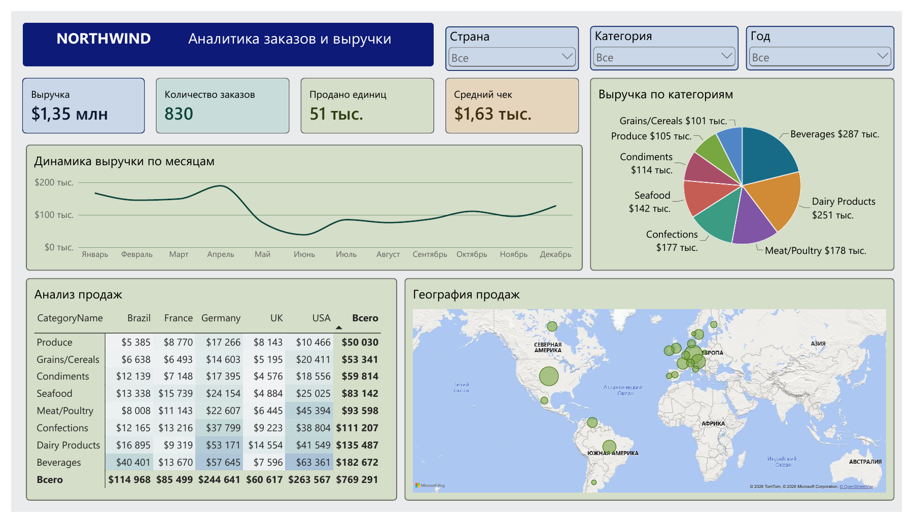

# Northwind · Анализ заказов и продаж

[Открыть PDF](dashboard.pdf) · [Скачать PBIX](northwind-sales.pbix) · [Продолжение: подготовка Sales и GuideDate](etl-extension/README.md) · [Все проекты](../README.md)



## Задача

Подготовить отчёт для сравнения продаж по товарным категориям, странам доставки и месяцам. Показать общий объём продаж, число заказов, количество проданных единиц и средний чек с возможностью детализации.

## Данные и подготовка

Источник — учебная база Northwind через [OData](https://services.odata.org/V3/Northwind/Northwind.svc/). Использованы Categories, Products и Orders.

В Power Query раскрыта вложенная таблица Order_Details: получены ProductID, UnitPrice и Quantity. Избыточные вложенные поля удалены. Итоговая таблица Orders содержит **2 155 товарных позиций**; одна строка — одна позиция заказа. OrderID повторяется у заказов с несколькими товарами.

## Модель

```text
Categories[CategoryID]  1 ── * Products[CategoryID]
Products[ProductID]    1 ── * Orders[ProductID]
```

Фильтр категории передаётся через Products к позициям Orders. Цена для расчёта берётся из конкретной операции Orders, а не из справочника Products.

## Показатели

| Название в отчёте | Смысл расчёта | Как интерпретировать |
| --- | --- | --- |
| Выручка | Сумма UnitPrice × Quantity по позициям | Стоимость продаж **до скидок**; Discount в подготовленную таблицу не включён |
| Количество заказов | Число уникальных OrderID | В полном наборе — 830 заказов; количество строк использовать нельзя |
| Продано единиц | Сумма Quantity | Количество единиц товара, а не заказов |
| Средний чек | Выручка / Количество заказов | В контексте категории — стоимость позиций выбранной категории на заказ, содержащий такие позиции |

Визуализации используют меры DAX. Здесь приведена логика показателей, а не выгрузка исходных формул из модели.

## Что сделано в отчёте

- Карточки четырёх показателей, график по месяцам и распределение по категориям.
- Матрица «категория × страна» с условным форматированием.
- Карта стран доставки; срезы для изменения контекста анализа.

## Наблюдения

В статическом экспорте продажи до скидок составляют около 1,35 млн в денежных единицах набора. Самые крупные категории — Beverages и Dairy Products; вместе они дают около 40% стоимости продаж. В матрице пяти выбранных стран наибольшие значения у USA и Germany.

## Ограничения и следующий шаг

- Название «Выручка» сохранено из исходного отчёта. Для бизнеса точнее обозначить показатель как «Продажи до скидок»; это также не прибыль.
- Матрица ограничена пятью странами: Brazil, France, Germany, UK, USA. Её итог нельзя напрямую сравнивать с общей карточкой без учёта фильтра.
- При выборе всех лет график по названию месяца объединяет одноимённые месяцы разных лет. Для последовательного временного ряда нужен ключ «год-месяц» с хронологической сортировкой.
- Денежные обозначения в учебном экспорте не подтверждают реальную валюту коммерческих операций.

Следующее развитие: учесть Discount, привести подписи и единицы к единому виду, добавить непрерывный календарь и сравнение сопоставимых периодов.
