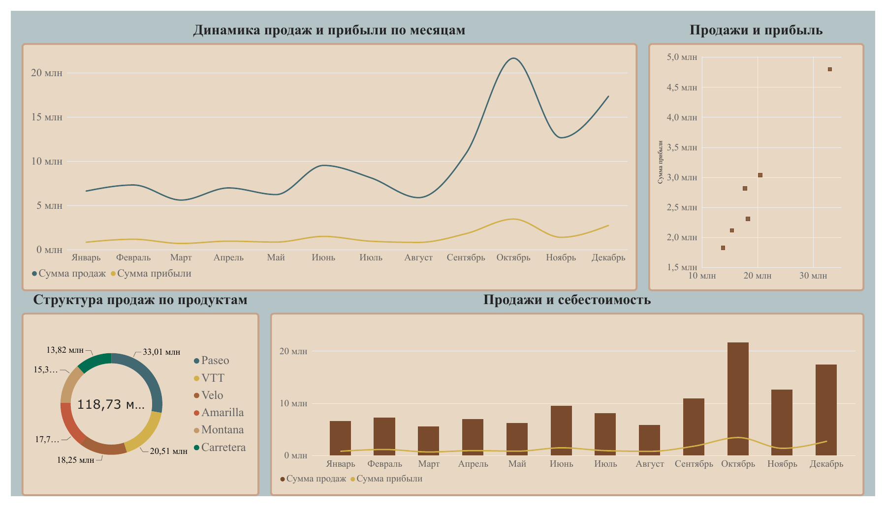

# Financials · Анализ продаж и прибыли

[Открыть PDF](dashboard.pdf) · [Скачать PBIX](financials-sales.pbix) · [Все проекты](../README.md)

## Задача

Сравнить продажи и прибыль по продуктам, странам и месяцам на основе Excel-таблицы. Предусмотреть выбор страны и понятное представление ключевых показателей.

## Данные и мой вклад

Учебный лист financials содержит **700 строк**. В Power BI выполнены загрузка книги Excel, анализ шагов Power Query «Источник», «Навигация», «Изменённый тип» и профилирование столбцов для проверки ошибок, пропусков и распределения значений.

Модель содержит одну таблицу financials. Для числовых полей проверены агрегации, для категориальных полей использованы соответствующие разрезы анализа.

Созданы карточка валовых продаж, срез Country, сравнение стран и страница с четырьмя диаграммами: продажи и прибыль по месяцам, структура продаж по продуктам, соотношение продаж и прибыли, комбинированное сравнение показателей.

## Показатели

| Поле | Смысл |
| --- | --- |
| Gross Sales | Валовые продажи до скидок |
| Sales | Продажи после скидок |
| Profit | Прибыль в исходном наборе |
| COGS | Себестоимость проданных товаров |

В этом кейсе используются агрегации полей исходной таблицы. Собственные меры DAX не являются основным результатом работы.

## Наблюдения и ограничения

По статическому экспорту наибольший вклад в продажи среди продуктов вносит Paseo — около 33,01 млн при суммарных продажах около 118,73 млн. Вывод относится к учебному набору и контексту страницы, а не к реальному рынку.

Группировка по названию месяца при нескольких годах объединяет разные периоды; для анализа временного тренда нужен год-месяц. В исходной странице встречаются подписи, которые стоит сверить с привязанными показателями: в частности, заголовок «Продажи и себестоимость» и легенда «Сумма прибыли».

В PDF представлены две информативные страницы исходного экспорта. Третья страница с незаполненной картой исключена из статического превью; в PBIX исходная структура сохранена.

Для обновления потребуется исходная книга Excel и актуальный путь к ней; отдельная книга в пакет не входит.
