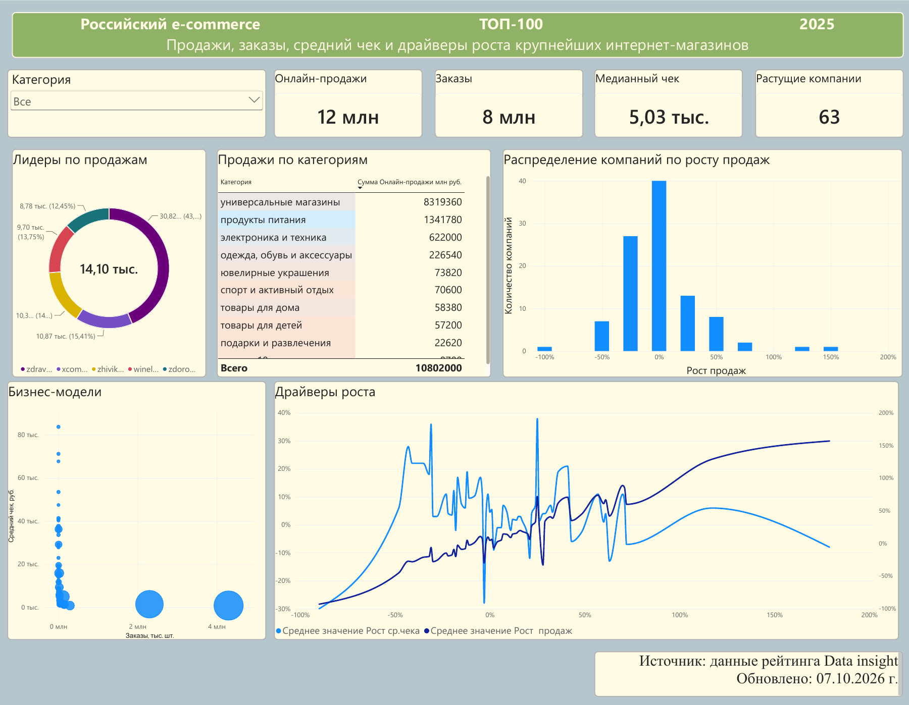

# E-commerce · Сравнение интернет-магазинов

**Статус: учебный прототип. Перед использованием итоговых KPI требуется сверка общей карточки продаж и таблицы категорий; подробнее — в ограничениях ниже.**

[Открыть PDF](dashboard.pdf) · [Скачать PBIX](ecommerce-rating.pbix) · [Все проекты](../README.md)

## Задача

Подготовить сравнительный отчёт по компаниям рейтинга: онлайн-продажи, количество заказов, средний чек и показатели роста. Предусмотреть выбор товарной категории.

## Источник и подготовка

Веб-таблица рейтинга Data Insight, указанная в исходной работе. Период в заголовке аналитической страницы — 2025; дата обновления экспорта — 07.10.2026. Это разные характеристики: дата обновления отчёта не заменяет период данных.

В Power Query выполнены подключение к таблице веб-страницы, проверка заголовков и типов данных, профилирование столбцов. Числовые значения приведены с учётом локали «Английский (США)», запрос назван «Рейтинг компаний».

## Результат

- Страница с фильтром категории и карточкой объёма онлайн-продаж.
- Аналитическая страница с карточками продаж, заказов, медианного чека и растущих компаний.
- Сравнение товарных категорий, диаграммы компаний и распределение показателя роста.
- Использование мер DAX «Продажи», «Заказы», «Медианный чек» и «Растущие компании».

## Как читать показатели

В исходной таблице продажи измеряются в **млн руб.**, заказы — в **тыс. шт.**, средний чек — в **руб.** Автоматическое сокращение «млн» на карточке нельзя интерпретировать без исходной единицы поля.

«Медианный чек» описывает медиану средних чеков компаний выборки. Это не медианный чек всех покупок и не взвешенный средний чек рынка. Доли компаний относятся к текущему контексту визуализации и не подтверждают долю всего российского e-commerce.

## Ограничения и дальнейшее развитие

Перед использованием отчёта для управленческого решения необходимо сверить контекст и состав строк: в исходном экспорте итог таблицы по категориям и общая карточка продаж визуально различаются. Стоит проверить фильтры, строки итогов исходного рейтинга и определения мер.

Дополнительно следует явно подписать единицы карточек и заменить соединение компаний линиями на подходящее сравнение точками или столбцами: компании не образуют временной ряд. Причины роста требуют отдельной проверки, одного графика недостаточно для причинного вывода.

PDF-превью содержит аналитическую страницу с обрезанными пустыми полями. Визуализации и числовые значения не перерисовывались; исходный PBIX не изменён. Внешняя веб-таблица может изменить структуру, поэтому обновление запроса нужно проверять отдельно.
