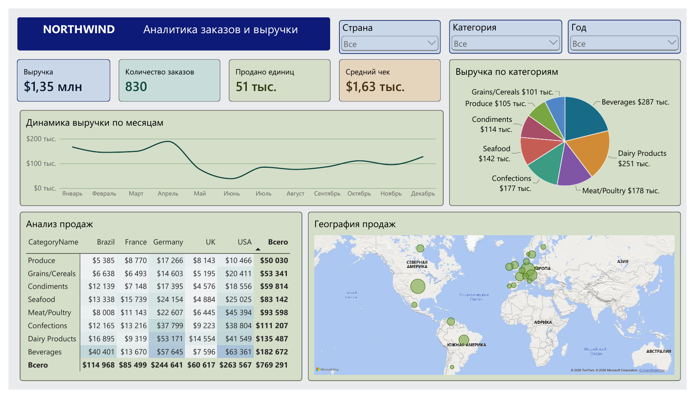
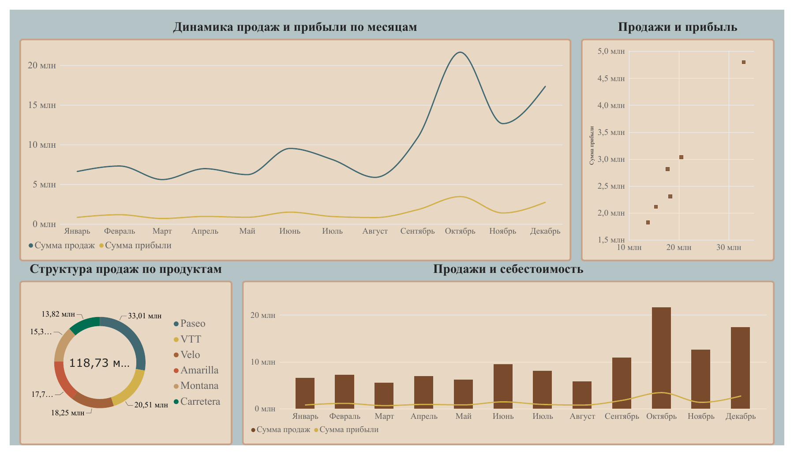
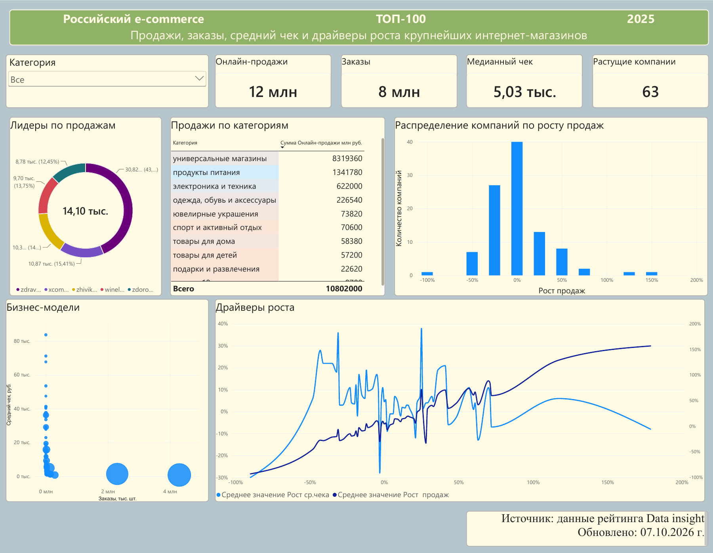

# Power BI · Аналитика продаж и данных

**Кристина Шишигина · Начинающий BI-аналитик**

Три учебных кейса: от подключения к источнику и подготовки данных до модели, показателей и интерактивного отчёта. Проекты показывают работу с Excel, веб-таблицей и OData, преобразования в Power Query, связи таблиц и использование мер DAX.

[Профиль GitHub](https://github.com/KristinaShishigina00) · [Другой BI-проект — AURA](https://github.com/KristinaShishigina00/aura-powerbi)

## Проекты

| Проект | Вопрос для анализа | Источник и навыки | Материалы |
| --- | --- | --- | --- |
| **Northwind — заказы и продажи** | Как распределены продажи по категориям, странам и месяцам? | OData, детализация заказов, связи 1:*, меры DAX; 2 155 товарных позиций | [Кейс](01-northwind/README.md) · [PDF](01-northwind/dashboard.pdf) · [PBIX](01-northwind/northwind-sales.pbix) |
| **Financials — продажи и прибыль** | Какие продукты и страны формируют продажи и прибыль? | Excel, профилирование 700 строк, типы данных, агрегации и фильтры | [Кейс](02-financials/README.md) · [PDF](02-financials/dashboard.pdf) · [PBIX](02-financials/financials-sales.pbix) |
| **E-commerce — рейтинг интернет-магазинов (прототип)** | Как сравнить компании и товарные категории по продажам, заказам и среднему чеку? | Веб-таблица, локаль чисел, показатели, сравнение компаний | [Кейс](03-ecommerce/README.md) · [PDF](03-ecommerce/dashboard.pdf) · [PBIX](03-ecommerce/ecommerce-rating.pbix) |

### Northwind

### Financials

### E-commerce

## Что можно оценить

- Подключение к разным источникам и подготовку данных в Power Query.
- Понимание детализации: товарная позиция отличается от заказа, стоимость продаж — от прибыли.
- Связи справочников с операционными данными и распространение фильтров.
- Использование мер DAX для показателей отчёта.
- Выбор разрезов анализа, оформление визуализаций и описание ограничений расчётов.

Отдельное [продолжение Northwind](01-northwind/etl-extension/README.md) показывает пользовательский столбец Sales и справочник дат GuideDate. Это развитие того же проекта, а не четвёртый независимый кейс.

## Как посмотреть

1. Для быстрого знакомства откройте кейс или PDF — Power BI для этого не нужен.
2. Для работы с моделью и фильтрами скачайте нужный `.pbix` и откройте в Power BI Desktop.
3. При обновлении данных проверьте параметры источников: для Excel нужен исходный файл и актуальный путь; для веб-таблицы и OData — доступность источника. Отдельные исходные Excel/CSV в этот репозиторий не включены.

Файлы PBIX сохранены с загруженной моделью. В этой публикации проверены структура файлов и статические экспорты; обновление источников в Power BI Desktop не проверялось.

## Контекст и источники

Работы выполнены в рамках учебной дисциплины «Инструменты бизнес-аналитики». Они демонстрируют навыки подготовки и анализа данных; коммерческий эффект внедрения не измерялся. Определения метрик и ограничения приведены в описаниях кейсов.

В [описании источников](SOURCES.md) указаны происхождение материалов и изменения статических превью. Исходные PBIX опубликованы без изменений.
